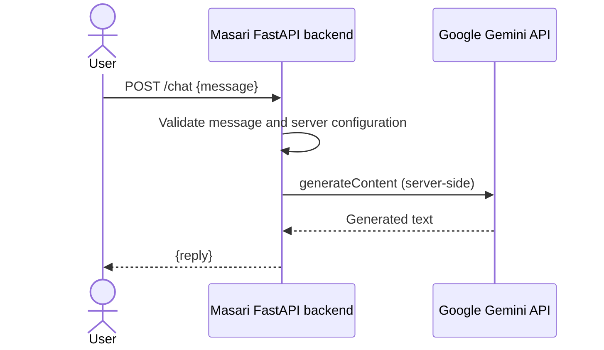

# Masari — Week 5 first AI model call

## 1. Project Overview

Masari is a planned AI guide for helping Grade 9 students and their families explore Egyptian Baccalaureate pathways. This milestone adds the first backend-to-model request; it does not implement the full product.

## 2. What Was Implemented

- A FastAPI `POST /chat` endpoint that accepts a message, sends it from the server to the Google Gemini API, and returns `{ "reply": "..." }`.
- Server-side configuration for the Gemini API key, model ID, and request timeout.
- Validation and sanitized errors for invalid input, missing configuration, provider failures, timeouts, and unexpected responses.
- Focused automated tests for the endpoint and its failure handling.

The endpoint uses Gemini's `generateContent` REST method. API keys are sent in the `x-goog-api-key` request header and are never returned to the caller or intentionally logged.

## 3. Why These Changes Were Made

The Week 5 brief requires proof of the request/response path through the project's own backend, with the model call kept off the frontend. The supplied architecture specifies Python/FastAPI and Google Gemini, and keeps pathway scoring deterministic and separate from the model. This implementation stays within that design and does not add a frontend, RAG, memory, scoring, or agent orchestration.

## 4. Architecture and Request Flow



The Gemini key remains on the backend. The LLM is only called by `/chat`; this endpoint does not perform pathway ranking.

## 5. Technologies and Dependencies

- Python 3.10 or later
- FastAPI and Uvicorn
- HTTPX for the Gemini REST request
- python-dotenv for local `.env` loading
- pytest for the focused backend tests

## 6. Project Structure

```text
backend/
  .env.example       Environment-variable template; contains no credentials
  main.py            FastAPI app and Gemini call
  requirements.txt   Runtime and test dependencies
  tests/
    test_main.py     Endpoint, validation, and provider-error tests
README.md            Setup, architecture, and Week 5 implementation notes
.gitignore           Excludes local credentials, virtual environments, and caches
```

## 7. Prerequisites

- Python 3.10 or later and `pip`.
- A Google Gemini API key for a live model call.
- The team's confirmed Gemini Flash-class model ID. The supplied planning documents defer the exact ID to Week 6, so it is configurable and is not guessed here.

## 8. Environment Configuration

From the repository root, copy `backend/.env.example` to `backend/.env`, then set:

- `GEMINI_API_KEY`: your Google Gemini API key.
- `GEMINI_MODEL`: the exact model ID approved by the team.
- `GEMINI_TIMEOUT_SECONDS`: optional request timeout from 1 to 120 seconds; defaults to 20.

Get a Gemini API key through [Google AI Studio](https://aistudio.google.com/app/apikey). See Google's [API key guidance](https://ai.google.dev/gemini-api/docs/api-key) and [generate content API](https://ai.google.dev/api/generate-content). Never commit `backend/.env`; only the empty template is tracked.

## 9. Installation and Setup

```bash
cd backend
python3 -m venv .venv
source .venv/bin/activate
python -m pip install -r requirements.txt
cp .env.example .env
```

Edit `backend/.env` with the key and confirmed model ID before a live call. Do not paste credentials into chat or commit them.

## 10. How to Run the Project

From the `backend/` directory with its virtual environment activated:

```bash
uvicorn main:app --reload --host 0.0.0.0 --port 8000
```

Interactive API documentation is available at `http://localhost:8000/docs` while the server is running.

## 11. How to Test the AI Integration

- Endpoint: `http://localhost:8000/chat`
- Method: `POST`
- JSON body: `{ "message": "Hello! What can you help me with?" }`
- Success response: `{ "reply": "<model-generated text>" }`

Example:

```bash
curl -sS http://localhost:8000/chat \
  -H 'Content-Type: application/json' \
  -d '{"message":"Hello! What can you help me with?"}'
```

Run the automated tests from `backend/` with `python -m pytest -q`. Those tests use an in-process HTTP transport to exercise request construction and error handling; they do not count as a live model call. A live test requires a valid `GEMINI_API_KEY`, the confirmed `GEMINI_MODEL`, network access, and an actual successful response from Gemini. Swagger UI at `/docs` can also send the request.

## 12. Error Handling

- Empty, whitespace-only, missing, or overlong messages: HTTP 422.
- Missing API key/model or invalid timeout/model configuration: HTTP 503.
- Gemini timeout: HTTP 504.
- Provider/network error or malformed model response: HTTP 502.

Error responses are generic and do not include the API key, user message, or raw upstream error details.

## 13. Implementation Status

**Implemented:** server-side `POST /chat`, input/config validation, Gemini REST request construction, response parsing, sanitized failure handling, and automated tests.

**Verified locally:** the automated suite passed; Uvicorn started, OpenAPI registered `POST /chat`, invalid input returned 422, and missing configuration returned 503. Validation responses omit submitted input.

**Live verification attempted, not successful (4 November 2026):** the API key was supplied securely, and Google's model-list endpoint returned HTTP 200 and listed the temporarily selected `gemini-3.8-flash` as supporting `generateContent`. A backend generation attempt timed out at 30 seconds; a second attempt with a 120-second timeout returned a sanitized provider-error response (HTTP 502). A direct provider diagnostic also timed out at 120 seconds. No real generated reply was received, so the end-to-end live requirement remains unverified. The provider's exact failure cause is not established.

The temporary test model was passed only through the test process's `GEMINI_MODEL` environment variable. No model ID is hardcoded or selected by default, and no team-approved model is implied. To complete the live check, set `GEMINI_MODEL` to the team's selected model, supply a valid key securely, and run the cURL request above.

**Outside this Week 5 change:** frontend, RAG/BM25 retrieval, deterministic pathway scoring, conversation memory, agent orchestration, and the remainder of the Masari product.

## 14. Files Changed

- `backend/main.py` — FastAPI endpoint and server-side Gemini request.
- `backend/requirements.txt` — application and test dependencies.
- `backend/.env.example` — non-secret configuration template.
- `backend/tests/test_main.py` — focused endpoint and error tests.
- `.gitignore` — excludes local secrets, virtual environments, and generated caches.
- `README.md` — setup, request flow, configuration, test instructions, and status.
