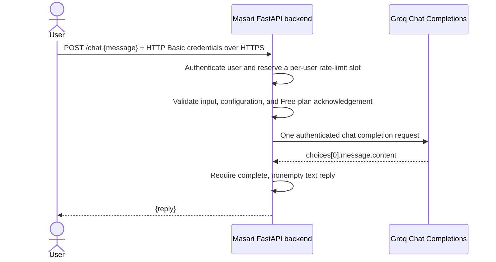

# Masari — Week 5 first AI model call

## 1. Project Overview

Masari is a planned AI guide for Grade 9 students and their families exploring Egyptian Baccalaureate pathways. This milestone proves the project's own backend can send a message to a real model and return generated text. It does not implement the full product.

**Provider baseline live verified on 4 November 2026:** at commit `a94873e`, the actual Uvicorn `POST /chat` endpoint returned HTTP **200** in **0.654 seconds**, with a real two-sentence Egyptian Arabic reply from Groq's `openai/gpt-oss-20b`. The subsequent authentication/rate-limit changes preserve that provider request and pass the authenticated regression suite. No new real inference was needed for the security update; its mocked tests are separate evidence.

## 2. What Was Implemented

- FastAPI `POST /chat`: `{ "message": "..." }` → `{ "reply": "..." }`.
- Local per-user HTTP Basic authentication with salted PBKDF2-SHA256 password hashes; no external identity service.
- Configurable, atomic, single-process per-user sliding-window limits with HTTP 429 and `Retry-After`.
- A direct, server-side Groq Chat Completions REST request using HTTPX.
- Explicit environment configuration for the model, key, timeout, and completion-token limit.
- A fail-closed Free-plan acknowledgement, input validation, sanitized errors, and status/timing-only application diagnostics.
- No automatic retries, redirects, model selection, provider fallback, paid-tier selection, or tools.

This is **direct Groq**, not Hugging Face routing. The user explicitly approved that change after the cost investigation.

## 3. Provider Selection and Free-Usage Constraints

### Selected model and route

- Provider: **Groq**, with an account on its **Free** plan.
- Model selected for verification: **`openai/gpt-oss-20b`**.
- Endpoint: **`POST https://api.groq.com/openai/v1/chat/completions`**.
- Authentication: server-side `Authorization: Bearer <GROQ_API_KEY>`.
- Body: `model`, `messages` containing one user turn, `max_completion_tokens`, and `stream: false`.
- Final text is read from `choices[0].message.content`; reasoning fields are not returned. A nonempty reply with `finish_reason: "stop"` is required.

Groq documents this as a production model with multilingual capability and approximately 1,000 tokens/second throughput. Its compact size and speed make it a reasonable first chatbot model; the observed Arabic response is a smoke test, not a comprehensive language-quality evaluation. The application has **no default model ID**: `GROQ_MODEL` must be supplied.

### Why not the Hugging Face router?

The official Hugging Face pricing page checked on 4 November 2026 lists **no included monthly inference credits for Free users**. Routed access normally requires purchased credits or a paid subscription. Groq is a supported HF provider, but appending `:groq` does not make that routing free. Custom-provider keys shift billing to the provider; they do not by themselves guarantee free usage. Direct Groq was approved instead of silently enabling HF billing.

### Cost safeguards and limitations

- The key was requested with an explicit prerequisite: verify its organization is on **Free**, not paid **Developer**, before submitting it.
- `GROQ_FREE_PLAN_CONFIRMED=true` is required before this backend sends inference. The template defaults to `false`.
- **This flag records operator acknowledgement; it does not query or enforce the account's billing tier.** Model-list success is not billing verification. If the organization upgrades later, disable the backend and re-evaluate costs before any further requests.
- Groq's Free plan is rate-limited, not unlimited. The published rate-limit table currently lists this model at 30 requests/minute, 1,000 requests/day, 8,000 tokens/minute, and 200,000 tokens/day; the organization's actual Console limits are authoritative and may differ. These exact account limits were not independently queried.
- The token cap defaults to 512 completion tokens per request (including reasoning) and is restricted locally to 1–1,024. Message length remains capped at 4,000 characters.
- The app sends only one upstream request per `/chat` call. It never automatically retries a limit error or switches models/providers.
- No billing, paid plan, purchased credits, automatic payment, or paid fallback was enabled during this work.
- The public test server was stopped after verification to avoid unintended consumption. `/chat` now requires authentication and per-user throttling, but HTTPS, login-abuse controls, and a deployment-wide quota strategy are still necessary before ongoing public use.

Official sources:

- [Groq model documentation](https://console.groq.com/docs/model/openai/gpt-oss-20b)
- [Groq API reference](https://console.groq.com/docs/api-reference#chat-create)
- [Groq Free/Developer billing distinction](https://console.groq.com/docs/billing-faqs)
- [Groq rate limits](https://console.groq.com/docs/rate-limits)
- [Hugging Face pricing](https://huggingface.co/docs/inference-providers/en/pricing)
- [Groq through Hugging Face](https://huggingface.co/docs/inference-providers/en/providers/groq)

## 4. Architecture and Request Flow



Credentials stay on the backend. Application diagnostics include only upstream HTTP status and elapsed time, or a generic timeout/network-failure label. They omit authorization headers, prompts, response bodies, and raw exception strings. This endpoint does not rank pathways or persist conversation history.

The user's own login credentials authenticate the request; the **Groq key and password-hash configuration are never sent to the client**. Authentication runs before JSON parsing, so an unauthenticated request cannot trigger provider work or body-validation details. Chat responses have `Cache-Control: no-store`.

## 5. Technologies and Dependencies

- Python 3.10 or later (verified here with Python 3.14).
- FastAPI and Uvicorn.
- HTTPX for the direct asynchronous REST request.
- python-dotenv for local `.env` loading.
- pytest for automated tests.

**No dependencies were added or removed by this migration.** The prior Gemini implementation already used HTTPX, not a Gemini SDK. No Groq, OpenAI, or Hugging Face SDK is needed. Existing `GEMINI_*` configuration is no longer read; previously stored secrets were not deleted or modified.

## 6. Project Structure

```text
backend/
  .env.example       Non-secret configuration template
  main.py            FastAPI endpoint and direct Groq request
  security.py        Hashed-password authentication and per-user sliding window
  create_chat_user.py Secure local account provisioning; no credential output
  requirements.txt   Existing runtime and test dependencies
  tests/
    test_main.py     Input, cost-guard, request, and error tests
    test_security.py Auth, rate limits, concurrency, privacy, and enrollment tests
README.md            Setup, design, costs, verification, and limitations
.gitignore           Excludes .env, virtual environments, and caches
```

The original planning documents remain unchanged. Their Gemini architecture is historical context, not the currently implemented provider.

## 7. Prerequisites and Secure Token Setup

1. Install Python 3.10+ and `pip`.
2. Use a Groq organization whose plan is confirmed as **Free** in [Groq Console billing](https://console.groq.com/settings/billing). Do not upgrade, add payment details, or buy credits for this milestone.
3. Create a dedicated backend API key at [Groq API Keys](https://console.groq.com/keys). It needs model inference access; no repository, Hugging Face, or account-management access is needed.
4. Store it as `GROQ_API_KEY` using Replit's secure Secrets interface or an untracked local `.env`. Never paste it into chat, commit it, print it, or put it in a command-line argument or URL.
5. Verify the configured model is listed by `GET /openai/v1/models`. This establishes model discoverability, not plan status or successful inference.

Conversation-owned Replit Secrets are not injected automatically into a shell. Use the scoped `replit secrets exec` startup command below in a Replit development sandbox.

## 8. Environment Configuration

| Variable | Required/default | Purpose |
| --- | --- | --- |
| `GROQ_API_KEY` | Required; no default | Backend API key |
| `GROQ_MODEL` | Required; no default | Exact model ID; verified target `openai/gpt-oss-20b` |
| `GROQ_FREE_PLAN_CONFIRMED` | Must be `true`; otherwise disabled | Operator confirmation of the account's Free plan |
| `GROQ_TIMEOUT_SECONDS` | Optional; `30` | HTTPX network-operation timeout, 1–120 seconds |
| `GROQ_MAX_COMPLETION_TOKENS` | Optional; `512` | Completion cap, integer 1–1,024 |
| `CHAT_AUTH_USERS` | Required; no default | Secret JSON mapping usernames to salted password hashes |
| `CHAT_RATE_LIMIT_REQUESTS` | Optional; `10` | Authenticated attempts allowed per user per window, integer 1–10,000 |
| `CHAT_RATE_LIMIT_WINDOW_SECONDS` | Optional; `60` | Sliding-window duration, integer 1–86,400 seconds |

The timeout is not a strict total-request deadline. Invalid configuration is rejected before any provider request. The fixed destination URL cannot be overridden through the model ID; URLs and routing-policy suffixes are rejected.

### Authentication setup

No real chat user or default password is shipped. From `backend/`, create each local account:

```bash
.venv/bin/python create_chat_user.py --username your-user
```

The helper privately prompts for the password twice and updates only the untracked `backend/.env`. It never prints passwords or hashes, preserves other settings, and uses owner-only file permissions (`0600`). It accepts 12–256 ASCII password characters; use a unique randomly generated password of at least 16 characters. Usernames are case-sensitive, 1–64 ASCII letters, digits, underscores, dots, or hyphens.

Each password gets a random 16-byte salt and PBKDF2-SHA256 with 600,000 iterations. Only the encoded hashes are stored in `CHAT_AUTH_USERS`; comparisons use `hmac.compare_digest`. Unknown usernames still perform a hash check, with the same generic 401 response. Plaintext passwords and malformed hash configuration are rejected.

For deployment, transfer the resulting `CHAT_AUTH_USERS` setting directly into the platform's secure Secrets interface, not into source code or chat. It and `GROQ_API_KEY` are backend-only settings. Use individual accounts rather than sharing one password. To rotate a password, rerun the helper; to revoke a user, remove their entry from the secret JSON. Update the deployment secret if applicable, and restart the server. Environment secrets take precedence over local `.env` values.

Missing/invalid account or rate-limit configuration disables `/chat` with 503. Authentication/rate settings are loaded when the app is created; restart after any changes. There is no browser session, signup flow, external auth service, or automatically provisioned deployment user.

### Rate-limiting behavior

Each verified username gets its own rolling window: by default **10 authenticated attempts per 60 seconds**. The values above apply independently to every account. The identity comes only from verified credentials, never `X-User-ID`, `X-Forwarded-For`, a query string, or the JSON body.

The middleware reserves a slot before body parsing/provider work. Authenticated invalid inputs, redirects, provider errors, and timeouts consume slots; rejected 401 logins do not consume another user's quota. On a local limit rejection, the response is HTTP 429 with `Retry-After` rounded up to the number of seconds until the oldest slot expires (minimum 1). Rejected attempts do not extend the window and never call Groq.

Counters use a monotonic clock and a lock so concurrent requests cannot exceed the per-process limit. These are local counters, **not a global Groq token budget**.

## 9. Installation and Setup

From the repository root:

```bash
cd backend
python3 -m venv .venv
source .venv/bin/activate
python -m pip install -r requirements.txt
cp .env.example .env
```

For local use, edit the untracked `backend/.env`: set the key, `GROQ_MODEL=openai/gpt-oss-20b`, and set `GROQ_FREE_PLAN_CONFIRMED=true` **only after confirming Free status**. Then run the account helper above. Keep HTTP debug logging disabled. Do not copy real credentials or password hashes into screenshots or submitted coursework.

## 10. How to Run the Project

Local startup, from `backend/` with the virtual environment active:

```bash
uvicorn main:app --host 127.0.0.1 --port 8000 --no-access-log
```

In a Replit sandbox using the securely stored conversation secret:

```bash
replit secrets exec --keys GROQ_API_KEY -- \
  env GROQ_MODEL=openai/gpt-oss-20b GROQ_FREE_PLAN_CONFIRMED=true \
  .venv/bin/uvicorn main:app --host 0.0.0.0 --port 8000 --no-access-log
```

Only use that confirmation flag after checking the organization's Free plan. This command also requires a valid `CHAT_AUTH_USERS` from the untracked `.env` or injected secret; otherwise `/chat` stays disabled. Run **one process** for the in-memory limiter (`--workers 1`, the default). Stop the server when done testing. API documentation is at `http://localhost:8000/docs`, and the schema is at `/openapi.json`. Swagger's **Authorize** control accepts a user's own HTTP Basic credentials, never the Groq key.

## 11. How to Test the AI Integration

```bash
curl -sS --user your-user http://localhost:8000/chat \
  -H 'Content-Type: application/json' \
  -d '{"message":"Explain what an API is in two short Egyptian Arabic sentences."}'
```

`curl --user your-user` prompts for the password rather than placing it in shell history or process arguments. Local HTTP is for loopback development only; use an **HTTPS** URL for any remote access. Never put passwords in URLs or use `--user username:password` with real credentials.

The request/response JSON contract is unchanged; authenticated access is now required:

- Request: `POST /chat`, JSON `{ "message": "<1–4000 characters>" }`.
- Success: HTTP 200, JSON `{ "reply": "<real generated text>" }`.

Run the entire automated suite from `backend/`:

```bash
.venv/bin/python -m pytest -q
.venv/bin/python -m pip check
```

The original 52 provider/input scenarios remain, with valid synthetic authentication added. Another 40 security cases cover authentication, per-user windows, `Retry-After`, exact expiry, concurrency, spoofed identities, proxy/mounted paths, fail-closed settings, salted hashes, private enrollment, and OpenAPI. The tests use mocked HTTP transports and consume no provider quota. They do not replace the earlier real-provider evidence.

## 12. Error Handling

| Condition | Client status |
| --- | --- |
| Missing, incorrect, unknown, or malformed HTTP Basic credentials | 401, with `WWW-Authenticate: Basic` |
| Missing/invalid chat-authentication or rate-limit settings | 503; fail closed |
| Local authenticated-user limit exceeded | 429, with numeric `Retry-After` |
| Missing, empty, whitespace-only, non-string, malformed, or overlong input | 422 |
| Missing/invalid configuration or no Free-plan confirmation | 503 |
| Provider authentication/access failure (401/403) | 503 |
| Provider payment/allowance failure (402) | 503; no paid fallback |
| Provider rate/free-usage limit (429) | 429 |
| Configured model unavailable (404) | 503 |
| Provider temporarily unavailable (503) | 503 |
| Network failure, other provider error, redirect, invalid/incomplete reply | 502 |
| Provider request timeout | 504 |

No raw upstream body is included in client errors. Validation responses omit submitted input and Pydantic context. Upstream status/timing diagnostics preserve the distinction between overload and other failures without exposing credentials or prompt text.

## 13. Verification and Implementation Status

### Automated verification — passed

- Complete suite after security changes: **92 passed** (all 52 original scenarios plus 40 new security cases), 4 November 2026.
- One existing Starlette TestClient deprecation warning; no test failures.
- Dependency consistency: **no broken requirements**.
- `git diff --check`: clean.

### Real HTTP security smoke — passed, explicitly mocked provider

A short-lived actual Uvicorn server on loopback returned **401** without credentials, **200** for an authenticated request, and **429** with **`Retry-After: 60`** for the next request at a one-request test limit. Exactly one mocked provider call occurred. Ephemeral credentials were generated in memory and were not printed or persisted. The server was stopped afterward. **No real Groq inference or free quota was used by this security update.**

### Previous actual live provider verification — passed at `a94873e`

One generation attempt was made through the real Uvicorn HTTP server and its configured sandbox endpoint, not through a mock or a direct-provider-only substitute:

| Check | Observed result |
| --- | --- |
| Authenticated model list | HTTP 200 in 0.152 seconds; selected model listed and active |
| Running server `/openapi.json` | HTTP 200; `POST /chat` registered |
| Model/provider | `openai/gpt-oss-20b` / direct Groq |
| Test task | Explain an API in two simple Egyptian Arabic sentences |
| FastAPI `/chat` result | **HTTP 200 in 0.654 seconds** |
| Backend-observed Groq result | **HTTP 200 in 0.630 seconds** |
| Generated text | Nonempty Arabic reply, 158 characters, complete stop |
| Generation attempts | **1**, no retries or fallback |
| Billing changes | **None** |

Actual generated reply:

> API هو برنامج صغير بيخلّيك تتواصل مع برنامج تاني أو خدمة على الإنترنت بدون ما تتعامل مع تفاصيل البرمجة. ببساطة، هو واجهة بتديك أوامر واضحة وترد عليك بالنتائج.

The test server was then stopped to protect the free quota. There is no always-on public demo. This is a connectivity smoke test, not evidence of unlimited free capacity, production readiness, pedagogical accuracy, or guaranteed response quality.

### Previous Gemini failure

The original Gemini implementation had timed-out generation attempts and a generic backend 502 without retained upstream details. A later controlled investigation, before this migration, captured Google **503 `UNAVAILABLE`** after **37.664 seconds**, explicitly reporting high demand. FastAPI mapped that to 502 after 37.689 seconds. That confirms overload for that attempt, not necessarily every earlier timeout. No successful Gemini response was claimed. The user subsequently approved direct Groq after the Hugging Face free-usage investigation.

### Remaining limitations

The account plan and exact organization quotas must be checked by the operator in Groq Console; they are not automatically detected by this application. The secure key request required Free-plan confirmation, but exact account quotas were not supplied or independently verified. Keep the account on Free.

### Security and deployment limitations

- **HTTPS is mandatory remotely.** HTTP Basic is Base64 encoding, not encryption. The app relies on a correctly configured TLS reverse proxy/hosting endpoint; it does not implement TLS itself. Do not log Authorization headers, request bodies, password hashes, or query strings containing credentials.
- **Use one worker/instance for this limiter.** Each process has independent counters; N workers/replicas can allow approximately N times the configured quota. Restarts clear counters. Scaling requires coordinated shared storage/edge enforcement; none is introduced or paid for here.
- **Per-user limits are not aggregate spending limits.** Many users or large prompts may still hit Groq's shared organization token/request limits. Preserve the Free plan and existing provider 429/no-retry behavior.
- **Protect login attempts at the ingress.** Failed authentication is not IP/global-throttled here. PBKDF2 is intentionally CPU-expensive, so an unrestricted login flood can consume server resources. Configure request/header/body-size limits, HTTPS, and login-abuse throttling before broad public exposure.
- Password hashes are sensitive, even though plaintext passwords are not stored. Use Secrets, strong unique passwords, individual accounts, and a rotation/revocation procedure. The local helper is intended for one operator at a time.
- HTTP Basic has no logout/session/refresh mechanism, user self-service, or MFA. `/docs` and `/openapi.json` remain public but contain no configured secrets; review their exposure for deployment.
- No new deployment user has been provisioned automatically. Until `CHAT_AUTH_USERS` is configured securely, `/chat` fails closed.

There is still no frontend, RAG, memory, pathway scoring, or agent orchestration. Authentication is a small local API access control, not a full student-account system.

## 14. Files Changed by the Migration

- `backend/main.py` — replace Gemini with direct Groq; preserve `/chat`, validation, privacy, and safe error handling; add cost acknowledgement and bounded output.
- `backend/.env.example` — non-secret Groq configuration and Free-plan guard.
- `backend/tests/test_main.py` — complete mocked migration and failure-path coverage.
- `README.md` — architecture, model/provider research, no-cost constraints, secure setup, and actual verification.

Dependencies, original planning documents, and `.gitignore` remain unchanged. The predecessor PR was merged; this migration belongs on a fresh branch from `main`, not on the already-merged branch.

### Security follow-up on PR #2

- `backend/security.py` — local hashed-password HTTP Basic authentication and atomic per-user sliding windows.
- `backend/create_chat_user.py` — private account enrollment into the untracked `.env`.
- `backend/main.py` — authenticate/throttle before body parsing and document HTTP Basic in OpenAPI; Groq request logic unchanged.
- `backend/.env.example` — authentication and rate-limit settings without credentials.
- `backend/tests/test_main.py` — preserve the original scenarios with authenticated clients.
- `backend/tests/test_security.py` — 40 security/configuration/concurrency tests.
- `README.md` — secure setup, curl usage, rate semantics, test evidence, and deployment limitations.

This follow-up updates the existing `feat/groq-free-chat` branch and PR #2. PR #1 was already merged before the follow-up; it was not changed, merged again, deleted, or rewritten.
