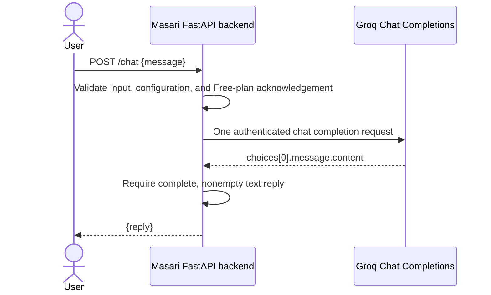

# Masari — Week 5 first AI model call

## 1. Project Overview

Masari is a planned AI guide for Grade 9 students and their families exploring Egyptian Baccalaureate pathways. This milestone proves the project's own backend can send a message to a real model and return generated text. It does not implement the full product.

**Live verified on 4 November 2026:** the actual Uvicorn `POST /chat` endpoint returned HTTP **200** in **0.654 seconds**, with a real two-sentence Egyptian Arabic reply from Groq's `openai/gpt-oss-20b`. Mocked tests are separate evidence.

## 2. What Was Implemented

- FastAPI `POST /chat`: `{ "message": "..." }` → `{ "reply": "..." }`.
- A direct, server-side Groq Chat Completions REST request using HTTPX.
- Explicit environment configuration for the model, key, timeout, and completion-token limit.
- A fail-closed Free-plan acknowledgement, input validation, sanitized errors, and status/timing-only application diagnostics.
- No automatic retries, redirects, model selection, provider fallback, paid-tier selection, or tools.

This is **direct Groq**, not Hugging Face routing. The user explicitly approved that change after the cost investigation.

## 3. Provider Selection and Free-Usage Constraints

### Selected model and route

- Provider: **Groq**, with an account on its **Free** plan.
- Model selected for verification: **`openai/gpt-oss-20b`**.
- Endpoint: **`POST https://api.groq.com/openai/v1/chat/completions`**.
- Authentication: server-side `Authorization: Bearer <GROQ_API_KEY>`.
- Body: `model`, `messages` containing one user turn, `max_completion_tokens`, and `stream: false`.
- Final text is read from `choices[0].message.content`; reasoning fields are not returned. A nonempty reply with `finish_reason: "stop"` is required.

Groq documents this as a production model with multilingual capability and approximately 1,000 tokens/second throughput. Its compact size and speed make it a reasonable first chatbot model; the observed Arabic response is a smoke test, not a comprehensive language-quality evaluation. The application has **no default model ID**: `GROQ_MODEL` must be supplied.

### Why not the Hugging Face router?

The official Hugging Face pricing page checked on 4 November 2026 lists **no included monthly inference credits for Free users**. Routed access normally requires purchased credits or a paid subscription. Groq is a supported HF provider, but appending `:groq` does not make that routing free. Custom-provider keys shift billing to the provider; they do not by themselves guarantee free usage. Direct Groq was approved instead of silently enabling HF billing.

### Cost safeguards and limitations

- The key was requested with an explicit prerequisite: verify its organization is on **Free**, not paid **Developer**, before submitting it.
- `GROQ_FREE_PLAN_CONFIRMED=true` is required before this backend sends inference. The template defaults to `false`.
- **This flag records operator acknowledgement; it does not query or enforce the account's billing tier.** Model-list success is not billing verification. If the organization upgrades later, disable the backend and re-evaluate costs before any further requests.
- Groq's Free plan is rate-limited, not unlimited. The published rate-limit table currently lists this model at 30 requests/minute, 1,000 requests/day, 8,000 tokens/minute, and 200,000 tokens/day; the organization's actual Console limits are authoritative and may differ. These exact account limits were not independently queried.
- The token cap defaults to 512 completion tokens per request (including reasoning) and is restricted locally to 1–1,024. Message length remains capped at 4,000 characters.
- The app sends only one upstream request per `/chat` call. It never automatically retries a limit error or switches models/providers.
- No billing, paid plan, purchased credits, automatic payment, or paid fallback was enabled during this work.
- The public test server was stopped after verification to avoid unintended consumption. This milestone has no application authentication or inbound rate limiting; do not expose it publicly for ongoing use without those controls.

Official sources:

- [Groq model documentation](https://console.groq.com/docs/model/openai/gpt-oss-20b)
- [Groq API reference](https://console.groq.com/docs/api-reference#chat-create)
- [Groq Free/Developer billing distinction](https://console.groq.com/docs/billing-faqs)
- [Groq rate limits](https://console.groq.com/docs/rate-limits)
- [Hugging Face pricing](https://huggingface.co/docs/inference-providers/en/pricing)
- [Groq through Hugging Face](https://huggingface.co/docs/inference-providers/en/providers/groq)

## 4. Architecture and Request Flow



Credentials stay on the backend. Application diagnostics include only upstream HTTP status and elapsed time, or a generic timeout/network-failure label. They omit authorization headers, prompts, response bodies, and raw exception strings. This endpoint does not rank pathways or persist conversation history.

## 5. Technologies and Dependencies

- Python 3.10 or later (verified here with Python 3.14).
- FastAPI and Uvicorn.
- HTTPX for the direct asynchronous REST request.
- python-dotenv for local `.env` loading.
- pytest for automated tests.

**No dependencies were added or removed by this migration.** The prior Gemini implementation already used HTTPX, not a Gemini SDK. No Groq, OpenAI, or Hugging Face SDK is needed. Existing `GEMINI_*` configuration is no longer read; previously stored secrets were not deleted or modified.

## 6. Project Structure

```text
backend/
  .env.example       Non-secret configuration template
  main.py            FastAPI endpoint and direct Groq request
  requirements.txt   Existing runtime and test dependencies
  tests/
    test_main.py     Input, cost-guard, request, and error tests
README.md            Setup, design, costs, verification, and limitations
.gitignore           Excludes .env, virtual environments, and caches
```

The original planning documents remain unchanged. Their Gemini architecture is historical context, not the currently implemented provider.

## 7. Prerequisites and Secure Token Setup

1. Install Python 3.10+ and `pip`.
2. Use a Groq organization whose plan is confirmed as **Free** in [Groq Console billing](https://console.groq.com/settings/billing). Do not upgrade, add payment details, or buy credits for this milestone.
3. Create a dedicated backend API key at [Groq API Keys](https://console.groq.com/keys). It needs model inference access; no repository, Hugging Face, or account-management access is needed.
4. Store it as `GROQ_API_KEY` using Replit's secure Secrets interface or an untracked local `.env`. Never paste it into chat, commit it, print it, or put it in a command-line argument or URL.
5. Verify the configured model is listed by `GET /openai/v1/models`. This establishes model discoverability, not plan status or successful inference.

Conversation-owned Replit Secrets are not injected automatically into a shell. Use the scoped `replit secrets exec` startup command below in a Replit development sandbox.

## 8. Environment Configuration

| Variable | Required/default | Purpose |
| --- | --- | --- |
| `GROQ_API_KEY` | Required; no default | Backend API key |
| `GROQ_MODEL` | Required; no default | Exact model ID; verified target `openai/gpt-oss-20b` |
| `GROQ_FREE_PLAN_CONFIRMED` | Must be `true`; otherwise disabled | Operator confirmation of the account's Free plan |
| `GROQ_TIMEOUT_SECONDS` | Optional; `30` | HTTPX network-operation timeout, 1–120 seconds |
| `GROQ_MAX_COMPLETION_TOKENS` | Optional; `512` | Completion cap, integer 1–1,024 |

The timeout is not a strict total-request deadline. Invalid configuration is rejected before any provider request. The fixed destination URL cannot be overridden through the model ID; URLs and routing-policy suffixes are rejected.

## 9. Installation and Setup

From the repository root:

```bash
cd backend
python3 -m venv .venv
source .venv/bin/activate
python -m pip install -r requirements.txt
cp .env.example .env
```

For local use, edit the untracked `backend/.env`: set the key, `GROQ_MODEL=openai/gpt-oss-20b`, and set `GROQ_FREE_PLAN_CONFIRMED=true` **only after confirming Free status**. Keep HTTP debug logging disabled. Do not copy real credentials into screenshots or submitted coursework.

## 10. How to Run the Project

Local startup, from `backend/` with the virtual environment active:

```bash
uvicorn main:app --host 127.0.0.1 --port 8000 --no-access-log
```

In a Replit sandbox using the securely stored conversation secret:

```bash
replit secrets exec --keys GROQ_API_KEY -- \
  env GROQ_MODEL=openai/gpt-oss-20b GROQ_FREE_PLAN_CONFIRMED=true \
  .venv/bin/uvicorn main:app --host 0.0.0.0 --port 8000 --no-access-log
```

Only use that confirmation flag after checking the organization's Free plan. Stop the server when done testing. API documentation is at `http://localhost:8000/docs`, and the schema is at `/openapi.json`.

## 11. How to Test the AI Integration

```bash
curl -sS http://localhost:8000/chat \
  -H 'Content-Type: application/json' \
  -d '{"message":"Explain what an API is in two short Egyptian Arabic sentences."}'
```

The API contract is unchanged:

- Request: `POST /chat`, JSON `{ "message": "<1–4000 characters>" }`.
- Success: HTTP 200, JSON `{ "reply": "<real generated text>" }`.

Run the entire automated suite from `backend/`:

```bash
.venv/bin/python -m pytest -q
.venv/bin/python -m pip check
```

The tests use mocked HTTP transports and consume no provider quota. They verify success, invalid/empty/malformed input, missing configuration, the Free-plan guard, invalid settings, authentication/access failures, credit/payment errors, rate limits, model unavailability, provider failures, timeouts, network errors, redirects, incomplete/invalid responses, privacy, and one-request/no-retry behavior.

## 12. Error Handling

| Condition | Client status |
| --- | --- |
| Missing, empty, whitespace-only, non-string, malformed, or overlong input | 422 |
| Missing/invalid configuration or no Free-plan confirmation | 503 |
| Provider authentication/access failure (401/403) | 503 |
| Provider payment/allowance failure (402) | 503; no paid fallback |
| Provider rate/free-usage limit (429) | 429 |
| Configured model unavailable (404) | 503 |
| Provider temporarily unavailable (503) | 503 |
| Network failure, other provider error, redirect, invalid/incomplete reply | 502 |
| Provider request timeout | 504 |

No raw upstream body is included in client errors. Validation responses omit submitted input and Pydantic context. Upstream status/timing diagnostics preserve the distinction between overload and other failures without exposing credentials or prompt text.

## 13. Verification and Implementation Status

### Automated verification — passed

- Complete suite: **52 passed**, 4 November 2026.
- One existing Starlette TestClient deprecation warning; no test failures.
- Dependency consistency: **no broken requirements**.
- `git diff --check`: clean.

### Actual live verification — passed

One generation attempt was made through the real Uvicorn HTTP server and its configured sandbox endpoint, not through a mock or a direct-provider-only substitute:

| Check | Observed result |
| --- | --- |
| Authenticated model list | HTTP 200 in 0.152 seconds; selected model listed and active |
| Running server `/openapi.json` | HTTP 200; `POST /chat` registered |
| Model/provider | `openai/gpt-oss-20b` / direct Groq |
| Test task | Explain an API in two simple Egyptian Arabic sentences |
| FastAPI `/chat` result | **HTTP 200 in 0.654 seconds** |
| Backend-observed Groq result | **HTTP 200 in 0.630 seconds** |
| Generated text | Nonempty Arabic reply, 158 characters, complete stop |
| Generation attempts | **1**, no retries or fallback |
| Billing changes | **None** |

Actual generated reply:

> API هو برنامج صغير بيخلّيك تتواصل مع برنامج تاني أو خدمة على الإنترنت بدون ما تتعامل مع تفاصيل البرمجة. ببساطة، هو واجهة بتديك أوامر واضحة وترد عليك بالنتائج.

The test server was then stopped to protect the free quota. There is no always-on public demo. This is a connectivity smoke test, not evidence of unlimited free capacity, production readiness, pedagogical accuracy, or guaranteed response quality.

### Previous Gemini failure

The original Gemini implementation had timed-out generation attempts and a generic backend 502 without retained upstream details. A later controlled investigation, before this migration, captured Google **503 `UNAVAILABLE`** after **37.664 seconds**, explicitly reporting high demand. FastAPI mapped that to 502 after 37.689 seconds. That confirms overload for that attempt, not necessarily every earlier timeout. No successful Gemini response was claimed. The user subsequently approved direct Groq after the Hugging Face free-usage investigation.

### Remaining limitations

The account plan and exact organization quotas must be checked by the operator in Groq Console; they are not automatically detected by this application. The secure key request required Free-plan confirmation, but exact account quotas were not supplied or independently verified. Keep the account on Free. There is no frontend, RAG, memory, pathway scoring, login, inbound rate limiter, or agent orchestration. Those features remain outside this milestone.

## 14. Files Changed by the Migration

- `backend/main.py` — replace Gemini with direct Groq; preserve `/chat`, validation, privacy, and safe error handling; add cost acknowledgement and bounded output.
- `backend/.env.example` — non-secret Groq configuration and Free-plan guard.
- `backend/tests/test_main.py` — complete mocked migration and failure-path coverage.
- `README.md` — architecture, model/provider research, no-cost constraints, secure setup, and actual verification.

Dependencies, original planning documents, and `.gitignore` remain unchanged. The predecessor PR was merged; this migration belongs on a fresh branch from `main`, not on the already-merged branch.
